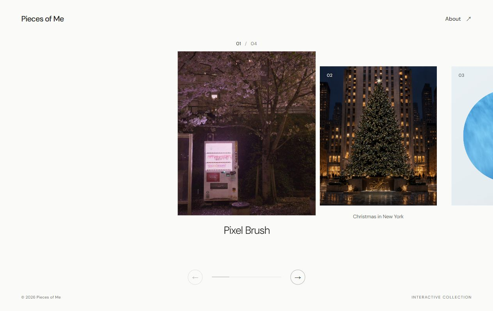
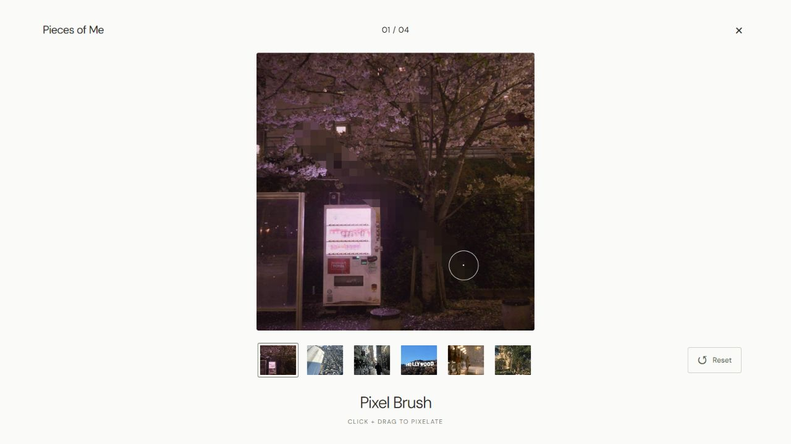
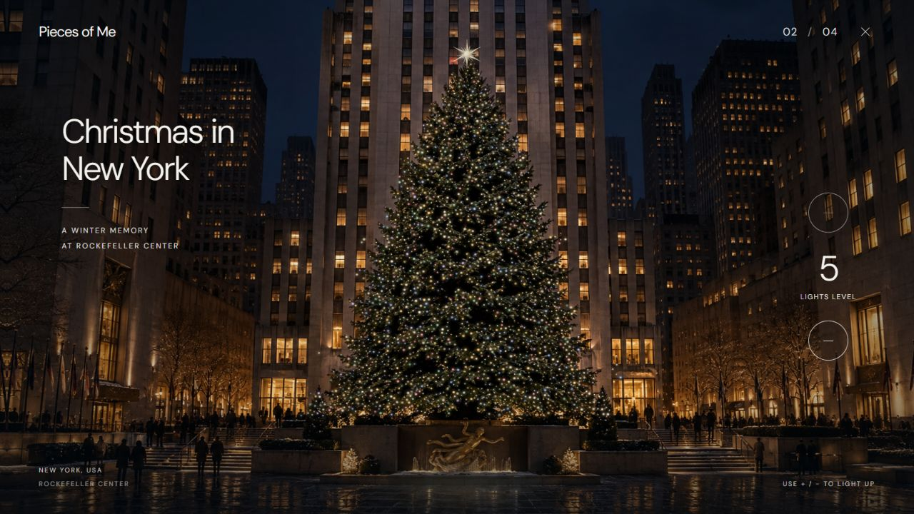
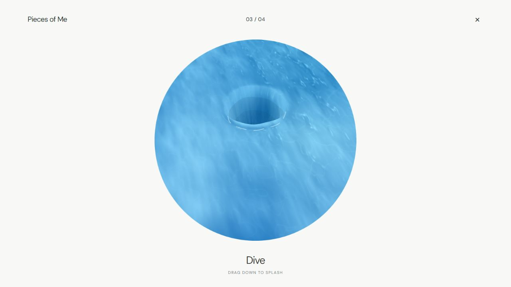
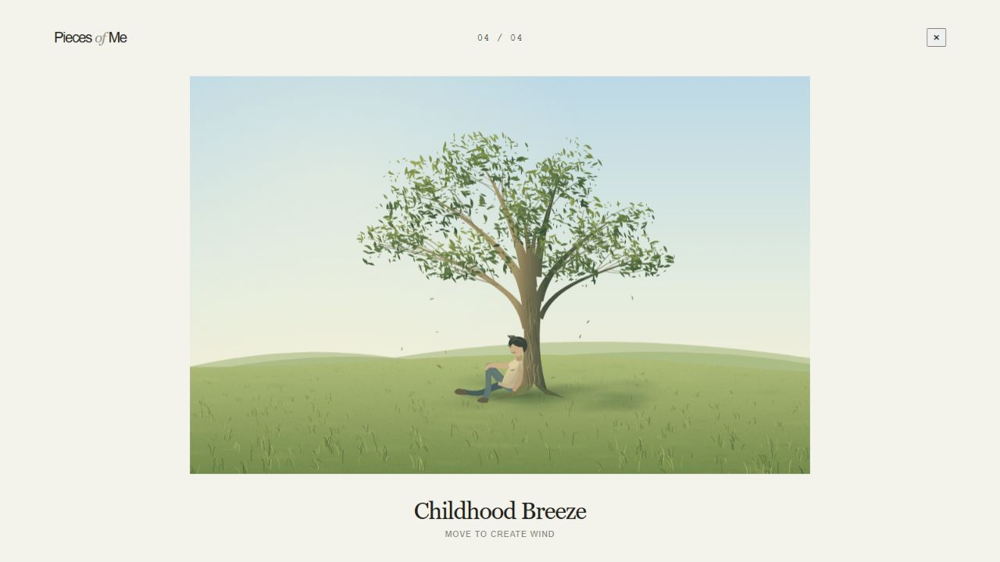

# Pieces of Me

### [↗ Pieces of Me 웹사이트에서 체험하기](https://pieces-of-me-two.vercel.app/)

설치 없이 브라우저에서 4개의 인터랙티브 작품을 직접 체험할 수 있습니다.

## 1. 제작한 것 소개

Pieces of Me는 개인적인 경험과 기억, 취향을 웹 인터랙션으로 표현한 개인 작품집입니다. 여행에서 본 크리스마스트리, 바다에서의 다이빙, 어린 시절 동산에서 쉬었던 순간, 픽셀과 이미지 표현에 대한 관심을 각각 하나의 작품으로 만들었습니다.

한 작품에 하나의 핵심 조작을 담고, 방문자가 직접 움직이거나 클릭하며 장면을 경험하도록 했습니다. React·TypeScript·Vite를 기반으로 Canvas와 SVG를 활용했으며, Vercel에 배포해 설치나 로그인 없이 브라우저에서 감상할 수 있습니다. 현재 제출 버전은 완성된 4개 작품으로 구성되어 있습니다.



Gallery에서는 가로 드래그, 마우스 휠, 하단 화살표로 작품을 탐색합니다. 카드를 클릭하면 작품에 진입하고, X 또는 `Esc`로 돌아오면 기존 선택 위치가 유지됩니다. 마우스와 키보드를 사용하는 데스크톱 환경을 기준으로 제작했습니다.

### 01. Pixel Brush

전공 수업에서 접한 픽셀 표현에 대한 관심을 바탕으로 만든 작품입니다. 사진 6장 중 하나를 고르고 **클릭한 채 드래그하면 지나간 영역만 픽셀화**됩니다. Reset으로 현재 사진을 원래 상태로 되돌릴 수 있으며, 세로 사진도 전체 구도가 잘리지 않도록 비율을 유지했습니다.



> 화면: 드래그한 경로만 픽셀 블록으로 바뀐 모습입니다. 아래 썸네일로 사진을 선택하고 Reset으로 다시 시작합니다.

### 02. Christmas in New York

뉴욕 Rockefeller Center의 겨울밤에 대한 기억을 트리를 켜는 경험으로 표현했습니다. **+ / − 버튼으로 조명을 0~5단계로 조절**하며, 마지막 단계에서는 전체 전구에 이어 꼭대기 별이 켜집니다. 조명의 배치와 색상, 별의 형태를 여러 차례 다듬었습니다.



> 화면: 전체 전구와 꼭대기 별이 켜진 5단계입니다. 오른쪽 + / − 버튼으로 점등 단계를 바꿉니다.

### 03. Dive

바다와 다이빙 경험에서 출발한 작품입니다. **원형 수면을 아래로 드래그하면** 물이 깊게 함몰된 뒤 물보라와 파동이 이어지고 서서히 복원됩니다. 드래그 거리와 속도로 입수 강도가 달라집니다. 조작 안내는 `DRAG DOWN TO SPLASH`입니다.



> 화면: 아래로 드래그한 뒤 수면이 움푹 들어간 순간입니다. 잠시 기다리면 물이 다시 차오릅니다.

### 04. Childhood Breeze

어린 시절 엄마, 형과 도서관에 다니며 근처 동산에서 나무에 기대어 쉬었던 기억을 표현했습니다. **마우스를 움직이는 방향과 속도에 따라 바람이 발생**하고, 가지·잎·풀·머리카락·옷자락이 서로 다른 정도로 반응합니다. 마우스를 멈추면 잔여 움직임이 천천히 잦아듭니다.



> 화면: 바람이 잦아든 낮의 동산입니다. 마우스를 좌우로 움직이면 나뭇가지와 풀의 방향이 달라집니다.

위 이미지는 실제 배포 사이트에서 캡처한 화면입니다. 움직임은 상단 작품 감상 링크에서 확인할 수 있습니다.

### 로컬 실행 방법

개발에 사용한 환경은 Node.js 22.18.0 / npm 10.9.3입니다. 저장소를 내려받은 뒤 다음 명령으로 실행합니다.

```bash
git clone https://github.com/rlawhh/pieces-of-me.git
cd pieces-of-me
npm ci
npm run dev
```

터미널에 표시된 주소를 브라우저에서 엽니다. 별도 환경변수는 필요하지 않으며, `npm run build`로 TypeScript 검사와 배포 빌드를 실행할 수 있습니다.

## 2. PRD와 TODO 리스트

- **[PRD.md — 기획서](PRD.md)**: 작품의 콘셉트와 핵심 인터랙션, 공통 UX, 디자인 방향을 정리했습니다. 최초 8개 기획과 현재 제출 범위를 함께 보존했습니다.
- **[TODO.md — 개발 계획과 변경 기록](TODO.md)**: 개발을 체크포인트로 나누고, 실제 구현·검증 결과와 변경 이유를 기록했습니다.

처음에는 Gallery 기반을 만든 뒤 Christmas → Pixel Brush → Dive → The Theatre of Dreams → Childhood Breeze → A Day in New York → Through the Rain → Folding City 순서로 개발하고, 통합 테스트와 문서화를 진행할 계획이었습니다.

현재는 Gallery와 제출 작품 4개가 완성되었고, 실제 배포 주소에서 핵심 동작을 확인했습니다. The Theatre of Dreams는 보류했으며 나머지 미구현 작품은 향후 개발 대상으로 남겼습니다. 추가 브라우저 검증과 최종 문서 검수 등 남은 항목도 TODO에서 완료와 구분했습니다. **개발 체크포인트 번호와 화면의 전시 번호는 서로 다릅니다.**

## 3. TODO 리스트 변경 내역

### 제출 범위 변경

최초에는 8개 작품을 구상했지만, 제출 기한과 각 작품의 완성도를 고려해 안정적으로 실행 가능한 4개를 우선 제출하기로 했습니다.

| 작품 | 최초 전시 번호 | 최종 제출 번호 |
| --- | --- | --- |
| Pixel Brush | 02 / 08 | 01 / 04 |
| Christmas in New York | 04 / 08 | 02 / 04 |
| Dive | 06 / 08 | 03 / 04 |
| Childhood Breeze | 08 / 08 | 04 / 04 |

A Day in New York, The Theatre of Dreams, Through the Rain, Folding City는 제출용 Gallery에서 제외했습니다. 최초 기획과 기존 자료는 보존했으며, 이 작품들을 완료한 것으로 표시하지 않았습니다.

### Gallery와 Loading

| 처음 계획 | 실제 결과 | 바꾼 이유 |
| --- | --- | --- |
| **Gallery:** 동일 크기 이미지의 가로 갤러리와 임시 미리보기 | 세로 카드, 중앙 선택 강조, 작품별 제목·번호와 실제 장면 미리보기로 수정 | 사용자 시안과 화면 검수를 반영해 작품 구분과 시각적 완성도를 높이기 위해 |
| **복귀 동작:** 작품을 닫으면 이전 선택 유지 | 화면 크기 변화와 숨겨진 Gallery의 재계산을 보완 | 테스트에서 작품 진입·복귀 후 선택이 달라지는 문제를 확인했기 때문 |
| **Loading:** 초기에는 화면 구조만 구현하고 디자인 검수 중 고정 대기 사용 | 실제 이미지 준비·Retry·취소·시간 제한을 연결한 뒤, 전환 디자인을 감상할 수 있도록 최소 2초 표시 복원 | 즉시 진입하면 로딩 화면이 거의 보이지 않아 사용자 요청으로 복원. 2초와 리소스 준비가 모두 끝나면 진입하며 X/ESC는 즉시 취소 |

### 작품별 수정과 테스트 후 반영

| 처음 계획 | 실제 결과 | 바꾼 이유 |
| --- | --- | --- |
| **Christmas:** 0~5단계 점등과 마지막 별 점등 | 조작은 유지하고 외곽 전구 분포·다색 조명·별 위치와 형태 수정 | 화면 검수에서 조명이 비거나 트리 밖에 놓이는 부분과 인위적인 별 표현이 지적됐기 때문 |
| **Pixel Brush:** 여러 이미지의 드래그 영역 픽셀화. 첫 버전은 임시 사진 5장과 가로 고정 Canvas | 사진 선택·Reset·경로 보간을 구현하고, 최종 사진 6장과 원본 비율 유지로 변경 | 최종 사진 선정을 반영하고 세로 사진이 잘리는 문제를 개선하기 위해 |
| **사진 용량:** 원본 합계 약 40 MB | 원본은 보존하고 배포용 사진을 약 1.91 MB로 최적화 | 전송 부담을 줄이기 위해. 교체 후 사진 선택·비율·픽셀화·Reset을 다시 확인 |
| **Dive:** 위아래 드래그로 수면 위·아래를 오가는 잠수·부상 | 기존 방식을 제외하고 입수 순간의 함몰·물보라·파동으로 변경. 중간 이름 Splash를 최종 Dive로 확정 | 여러 차례 수정해도 잠수 감각이 약해, 직접 결과를 보고 더 직관적인 표현을 선택했기 때문 |
| **Childhood Breeze 바람:** 마우스 방향·속도에 반응 | 첫 버전에서 입력 범위·반응 크기·잔여 움직임을 보강하고 요소별 반응 차등 적용 | 마우스를 움직여도 인터랙션이 없는 것 같다는 사용자 검수 의견 때문 |
| **Childhood Breeze 장면:** 나무와 기대앉은 아이 | 비대칭 수관·깊이감과 아이 자세를 개선 | 반복적인 풀·가지와 불명확한 자세를 다듬되 기존 색감·구도·바람을 유지하기 위해 |

### 보류한 작업과 새로 추가한 기록

| 처음 계획 | 실제 결과 | 바꾼 이유 |
| --- | --- | --- |
| **The Theatre of Dreams:** Old Trafford 내부를 360도로 감상 | 기술·자산 조사 후 구현 보류 | 경기장 내부 품질과 자산 확보의 부담을 고려했기 때문. 다른 세 미구현 작품도 제출 기한을 고려해 Gallery에서 제외 |
| **작업 기록:** PRD/TODO와 기본 규칙 중심 | 프로젝트 전용 Skill과 변경 이유·검증 기록 추가 | 반복 수정의 범위를 관리하고, 과제에서 요구한 제작 과정을 남기기 위해 |

기획을 바꾼 부분뿐 아니라, 핵심 기능은 유지하면서 테스트 결과로 다듬은 부분도 기록했습니다. 초기 잠수·부상 프로토타입은 로컬에 보존하고 Git에서는 제외했으며, 현재 Dive에는 사용하지 않습니다.

비교 기준은 [최초 PRD](https://github.com/rlawhh/pieces-of-me/blob/53527bf/PRD.md)와 [최초 TODO](https://github.com/rlawhh/pieces-of-me/blob/53527bf/TODO.md)입니다. 상세 변경 이유와 검증은 [현재 TODO](TODO.md), 구현 기록은 [Git 커밋 이력](https://github.com/rlawhh/pieces-of-me/commits/main/)에서 확인할 수 있습니다.

최종적으로 로컬 빌드와 실제 Vercel 주소에서 Gallery 탐색, 네 작품의 핵심 조작, X/ESC 복귀와 선택 위치 유지를 확인했습니다. 로딩 실패·재시도는 로컬 배포 미리보기에서, 중단·시간 초과는 모의 환경에서 확인했으며 실제 배포 장애 테스트와는 구분했습니다.

## 4. Agent Skill

### pieces-of-me-development — 프로젝트 전용 개발 스킬

[**SKILL.md 원문 보기**](.agents/skills/pieces-of-me-development/SKILL.md)

- **내용:** PRD/TODO와 현재 코드를 확인하고, 요청한 범위 안에서 구현한 뒤 변경 이유·실제 완료 상태·검증 결과를 기록하는 절차입니다. 사용자 승인 후에만 Commit/Push하도록 했습니다.
- **직접 만든 이유:** 여러 작품을 반복 수정하면서 다른 작품이나 유지해야 할 요소가 함께 바뀌지 않도록 하고, 처음 계획이 왜 달라졌는지 빠짐없이 남기기 위해서입니다. AGENTS.md의 규칙을 복사하는 대신 작업 순서로 정리했습니다.
- **사용 방법:** `.agents/skills/pieces-of-me-development/SKILL.md`에 두고 `$pieces-of-me-development`로 호출했습니다. 이름과 사용 시점은 YAML 메타데이터로 정의했습니다.

### 실제로 어떻게 쓰였나

예를 들어 Childhood Breeze의 아이 자세를 수정할 때 다음과 같이 요청했습니다.

```text
$pieces-of-me-development 스킬을 사용해
Childhood Breeze에서 아이의 앉은 자세만 수정해줘.
나무·언덕·색감·바람 인터랙션은 유지해줘.
Commit/Push는 하지 마.
```

| 사용한 작업 | 스킬을 따라 수행한 내용 | 결과 |
| --- | --- | --- |
| Childhood Breeze의 아이 자세 수정 | PRD/TODO와 코드를 읽고 아이를 그리는 부분만 수정. 바람 코드 보존 여부와 빌드·화면 확인 후 이력 기록 | 한쪽 무릎에 팔을 얹고 기대앉는 자세를 만들면서 나무·언덕·색감·바람 유지 |
| 제출용 Gallery 구성 | 최초 8개 기획 보존, 완성된 4개의 순서·번호 정리, 진입·복귀·진행 표시 확인 | 작품 ID와 개별 인터랙션을 바꾸지 않고 제출 범위 반영 |
| 사진·Loading 개선 | 원본 보존, 최적화 사진 연결, 자원 준비·실패·재시도 검증, TODO에 결과와 남은 항목 기록 | 실제 로딩 연동과 실패 후 복귀·재시도 확인. 이후 사용자 요청에 따라 최소 2초 표시 복원 |
| 최초 계획 비교와 README 작성 | Git 이력과 최초 PRD/TODO를 비교하고 구현·보류·미확인을 구분 | 변경 이유를 설명하고, 확인하지 않은 작업을 완료로 적지 않도록 정리 |

이렇게 스킬을 사용하면서 작업 범위를 지키고, 변경 이유와 검증 결과를 같은 방식으로 남길 수 있었습니다. 스킬 생성 전의 모든 작업에 이 스킬을 사용한 것은 아닙니다.

### SKILL.md 전체 내용

<details>
<summary>스킬 원문 펼치기</summary>

````markdown
---
name: pieces-of-me-development
description: Pieces of Me의 작품 개발, 디자인 및 인터랙션 개선, 검증과 TODO 변경 이력 관리를 수행한다. 이 저장소의 특정 체크포인트 구현·사용자 피드백 반영·빌드 및 브라우저 검증·계획 대비 변경 분석을 요청할 때 사용한다. 읽기 전용 검토에서는 분석만 수행한다.
---

# Pieces of Me 개발 워크플로

## 목적과 입력

개인적인 기억을 하나의 핵심 인터랙션으로 표현하는 작품집을 개발하며, 계획·구현·검증·사용자 검수를 구분해 기록한다. 입력은 사용자의 현재 요청, 대상 작품과 체크포인트, 관련 피드백이다.

이 파일의 위치에서 세 단계 위가 프로젝트 루트다. 작업 디렉터리가 달라도 루트의 `AGENTS.md`, `PRD.md`, `TODO.md`를 기준으로 한다. 프로젝트 전반의 제약은 `AGENTS.md`를 참조하고 여기에서 다시 정의하지 않는다. 스킬 호출 자체는 구현·문서 수정·Commit/Push 권한을 추가하지 않는다.

## 1. 현재 계획과 작업 범위 확인

- `PRD.md`의 해당 작품 요구사항과 `TODO.md`의 현재 체크포인트를 읽는다. 전시 번호와 개발 체크포인트 번호를 혼동하지 않는다.
- 최신 사용자 요청에서 확정한 변경과 문서의 차이를 찾는다. 확정되지 않은 콘셉트·기술·범위는 임의로 정하지 않는다.
- `git status --short`와 관련 diff를 확인해 기존 변경과 이번 작업을 구분한다. 기존 미반영 작업을 덮어쓰거나 되돌리지 않는다.
- 요청을 구현, 디자인 개선, 검증, 읽기 전용 분석 중 어떤 작업으로 수행할지 정한다. 읽기 전용이면 파일 수정·빌드·서버 실행·Git 변경을 생략하고 근거 확인과 보고만 한다.

## 2. 기존 구조 안에서 구현

- 해당 작품의 진입 컴포넌트, 입력 처리, 렌더링, 대표 이미지 연결 위치를 확인한 뒤 필요한 파일만 수정한다.
- 작품별 코드를 분리하고 Gallery → Loading → 작품 → Gallery의 공통 흐름을 보존한다. 요청에 포함되지 않은 작품의 상태나 디자인을 바꾸지 않는다.
- 핵심 인터랙션 하나에 집중한다. 사용자 피드백을 입력 범위·감도·움직임·가독성 등 관찰 가능한 수정 목표로 바꾼다.
- 새로운 dependency나 주요 기술 변경이 필요하면 적용 전에 이유·영향을 설명하고 사용자 승인을 받는다.

## 3. 디자인과 인터랙션 피드백 반영

- 문제가 입력 미수신인지, 상태 계산 문제인지, 화면에서 알아보기 어려운 반응인지 구분한다.
- 배경·주요 피사체·공통 UI를 유지하라는 요청이 있으면 해당 부분을 수정 범위에서 제외한다.
- 움직임은 시작·반응 중·입력 종료·잔여 반응까지 확인한다. 숫자나 내부 상태가 변한다는 사실만으로 사용자가 인터랙션을 인지한다고 판단하지 않는다.

## 4. 최초 계획 대비 변경 이력 추적

- 현재 TODO를 덮어쓰기 전에 비교 기준을 찾는다. 필요할 때 `git log --oneline -- PRD.md TODO.md`, `git show <확인한 커밋>:TODO.md`, 관련 diff와 사용자 대화에서 최초 계획 및 변경 근거를 확인한다.
- 항목 추가·삭제·수정·보류·복구를 구분한다. 이전 요구사항을 지우는 대신 해당 체크포인트의 변경 기록에 이전 계획과 바뀐 결과를 남긴다.
- 기록 단위는 아래 형식을 따른다. 기존 문서 형식이 있으면 같은 정보를 그 형식에 맞춰 적는다.

```text
기록일 / 체크포인트 / 변경 유형:
최초 계획 또는 이전 상태:
변경 후 요구사항 및 실제 반영 방법:
변경 이유와 근거: 사용자 요청, 관찰한 문제 또는 검증 결과
영향 범위:
검증 결과 / 남은 결정 및 검수:
```

- 작성한 날짜와 실제 변경 발생일을 구분한다. 과거 근거가 부족하면 발생일·이유를 미확인으로 남기며, 현재 PRD를 최초 계획으로 단정하지 않는다.
- 읽기 전용 분석이면 위 내용을 답변으로 제시하고 TODO에 쓰지 않는다. 분석 중 발견한 문서 누락도 임의로 수정하지 않는다.

## 5. 실제 상태를 TODO에 반영

- 수정이 허용된 작업에서는 구현과 검증이 확인된 작은 항목만 체크한다. 미확인·보류·진행 중과 사용자 최종 승인 대기를 구분한다.
- 기능 구현 및 빌드 성공을 작품 전체의 완료나 최종 디자인 승인으로 취급하지 않는다. 다른 체크포인트 상태를 이번 작업에 끼워서 바꾸지 않는다.
- 계획과 구현이 달라졌으면 체크박스뿐 아니라 4단계의 변경 이력을 함께 남긴다. PRD 수정이 요청 범위를 벗어나면 차이를 보고한다.

## 6. 필요한 검증 수행

- 사용자 요청에 포함된 검증을 우선한다. 구현 검증이 요청되었으면 루트의 `npm run build` 결과를 확인하고, 수정한 입력과 공통 진입·복귀 흐름을 브라우저에서 확인한다.
- 개발 서버가 필요하면 실행 여부와 주소부터 확인해 중복 실행을 피한다. 브라우저 조작은 사용 가능한 정식 도구로 수행한다.
- 해당 입력의 방향·강도·경계·연속 입력·중지 후 복원을 확인하고, 실제 화면에서 움직임과 가독성을 본다. 상태값 확인은 시각 검증을 보조하는 근거로 사용한다.
- 공통 흐름은 Loading 취소, 작품 진입, X/ESC 복귀, Gallery 선택 위치 유지, 작품 입력과 Gallery 입력 충돌 여부를 확인한다. 변경 범위와 무관한 검사를 기계적으로 반복하지 않는다.
- 빌드, 브라우저 직접 확인, 사용자 확인, 코드 검토만 한 항목, 미확인을 분리한다. 이전 검증을 이번 실행 결과처럼 기록하지 않는다.
- 자산·의존성·배포를 다루는 요청에서는 사용 조건과 공개 저장소 포함 가능 여부를 확인한다. 확인되지 않은 권리를 추정하지 않는다.

## 7. 결과 보고와 Git 경계

- 변경 파일, 무엇을 왜 어떻게 바꿨는지, 실제 검증 결과, 남은 검수·한계를 간결하게 보고한다. 읽기 전용이면 수정 파일이 없다는 사실을 명시한다.
- README 작성이 요청되면 스킬 제작 이유, 실제 적용한 작업, 따른 절차, 관찰한 결과를 근거와 함께 설명한다. 생성 이전 작업에 이 스킬을 사용했다고 소급해서 적지 않는다.
- Commit/Push는 사용자가 승인한 범위에서만 수행한다. 이번 요청에서 금지했으면 이전 승인과 관계없이 수행하지 않는다. 승인된 Git 작업에서도 검증 실패 시 중단하고, 관련 없는 변경을 포함하지 않는다.

## 명시적 호출 예시

`$pieces-of-me-development 스킬을 사용해 CHECKPOINT 08의 TODO 변경 이력을 최초 계획과 비교해 읽기 전용으로 분석해줘. 파일 수정, 빌드, Commit/Push는 하지 마.`
````

</details>

## 5. 느낀 점과 결론

이번 프로젝트를 진행하면서 가장 크게 느낀 점은 **생각했던 아이디어를 실제로 구현하는 것과, 그 결과물이 마음에 들도록 완성하는 것은 전혀 다른 문제**라는 것이었습니다.

처음에는 AI를 활용하면 원하는 기능과 디자인을 비교적 쉽게 만들 수 있을 것이라고 생각했습니다. 실제로 기본적인 기능은 빠르게 구현할 수 있었지만, 머릿속으로 상상했던 장면과 브라우저에 나타난 결과물 사이에는 생각보다 큰 차이가 있었습니다. 특히 디자인이나 움직임처럼 정답이 없는 부분에서는 코드를 여러 번 수정해도 만족스러운 결과가 나오지 않는 경우가 많았습니다.

가장 기억에 남는 과정은 Dive의 개발입니다. 처음에는 마우스를 드래그해 바닷속으로 잠수하고 다시 올라오는 작품을 만들려고 했습니다. 하지만 여러 차례 구현하고 수정해도 실제로 물에 들어가는 느낌이 제대로 전달되지 않았습니다. 결국 기존 방식에 계속 매달리기보다, 친구들과 다이빙하러 갔을 때 물에 뛰어드는 모습을 바라보던 경험에서 아이디어를 얻어 물보라와 수면의 움직임을 표현하는 방식으로 변경했습니다. 오히려 이렇게 방향을 바꾼 이후 작품의 특징이 더 분명해졌습니다.

가장 만족스러웠던 작품은 Christmas in New York입니다. 실제 뉴욕 여행에서 보았던 크리스마스트리를 떠올리며 만든 작품이라 개인적으로 의미가 컸습니다. 처음 구현된 트리는 단순하고 인위적인 느낌이 강했지만, 전구의 색상과 위치, 조명이 켜지는 단계, 꼭대기 별의 형태 등을 하나씩 수정하면서 원하는 분위기에 가까워졌습니다. 작은 디테일 하나가 전체 결과물의 인상을 크게 바꿀 수 있다는 것도 이 과정에서 느꼈습니다.

AI와 협업하는 방식에 대해서도 생각이 많이 달라졌습니다. 초반에는 프롬프트를 길고 자세하게 작성할수록 결과가 좋아질 것이라고 생각했지만, 실제로는 이미 완료한 작업을 다시 확인하거나 원하지 않은 부분까지 수정하는 일이 생기기도 했습니다. 이후에는 **수정할 부분과 그대로 유지할 부분을 명확하게 전달하고, 작은 작업 단위로 결과를 확인하는 방식**으로 바꿨습니다. AI가 코드를 작성해 주더라도 무엇을 만들지 결정하고, 결과를 직접 확인하고, 부족한 부분을 판단하는 과정은 결국 개발자의 역할이라는 것을 알게 되었습니다.

최초에는 8개의 작품을 계획했지만, 이번 제출에서는 4개의 작품을 완성했습니다. 계획했던 모든 작품을 구현하지 못한 점은 아쉽지만, 무리하게 작품 수를 채우기보다는 실제로 작동하는 작품을 반복해서 개선하는 데 집중했습니다. 또한 PRD와 TODO를 바탕으로 개발 과정을 관리하고, GitHub에 작업 내용을 단계적으로 기록하면서 단순히 결과물을 만드는 것뿐 아니라 개발 과정을 남기는 일도 중요하다는 것을 배웠습니다.

이번 프로젝트를 통해 AI를 활용하면 개발을 시작하는 부담은 줄일 수 있지만, **완성도 높은 결과물을 만드는 과정까지 자동으로 해결되는 것은 아니라는 점**을 경험했습니다. 앞으로도 AI를 적극적으로 활용하되, 생성된 결과를 그대로 받아들이기보다 직접 검토하고 개선하면서 제가 의도한 결과물을 만들어 가고 싶습니다.
